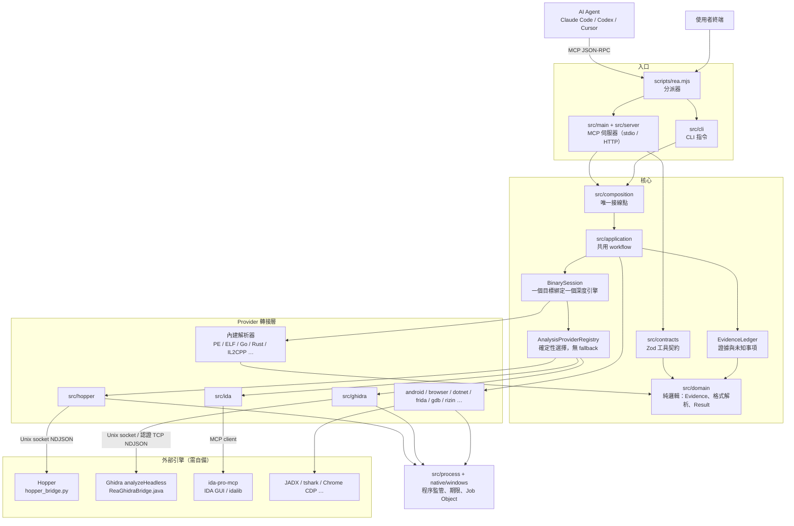
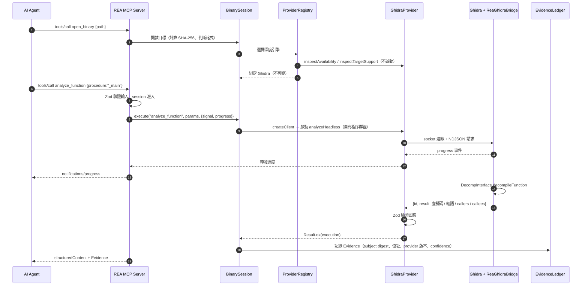
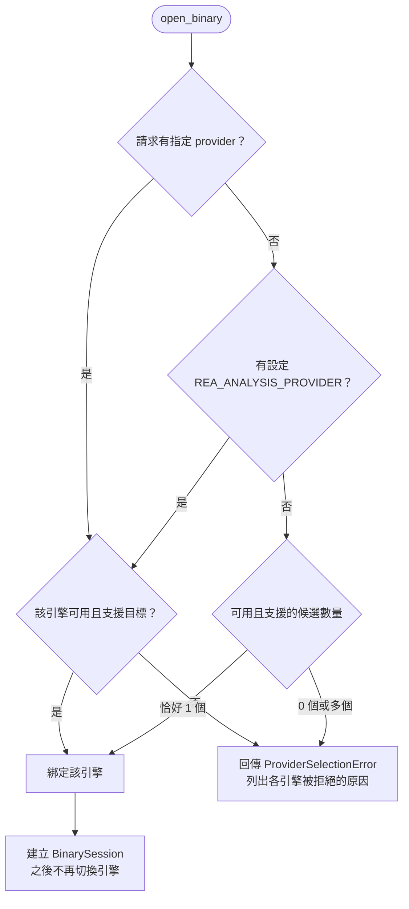

# REA（Reverse Engineer Anything）專案解析報告

- 原始碼位置：`E:\source\1.Open Source\rea`
- 套件：`rea-agents` v6.8.0（MIT）
- 語言：TypeScript / Node.js（`src` 約 57 萬行非測試程式碼），另有 Python、Java、C++、Swift 橋接程式
- 日期：2026-11-05

---

## 1. 它是什麼

REA 是一個 **MCP 伺服器加 CLI**。它本身**不是反編譯器**，而是一層「中介與協調」：

```
AI Agent（Claude Code / Codex / Cursor…）
      │  MCP（JSON-RPC over stdio 或 HTTP）
      ▼
REA MCP Server ── 與 CLI 共用同一套 workflow
      │
      ├─ 深度分析引擎（外部，需自備）：Hopper / Ghidra / IDA / Kuna
      ├─ 外部工具：JADX、Binwalk、tshark、Frida、GDB、Rizin、objdump、Chrome CDP…
      └─ 內建解析器（純 TS）：PE、ELF、Go buildinfo、Rust、IL2CPP、.NET IL、GGUF…
      ▼
回傳帶有「證據（Evidence）」的結構化結果
```

它的核心價值有三點：

1. **統一介面**：把各家逆向工具統一成同一組 MCP 工具（約 160 個），讓 LLM 可以直接呼叫。
2. **證據導向**：每個結論都附上證據和出處，並區分「觀察到的、計算得出的、推論的、未知的」。
3. **生命週期管理**：嚴格管理外部程序，在 AI 不斷呼叫工具的情境下也不會殘留程序或洩漏資源。

---

## 2. 目錄架構（依賴由外往內）

依據 `AGENTS.md` 與 `docs/architecture.mermaid`：

| 層 | 目錄 | 職責 |
|---|---|---|
| 入口 | `scripts/rea.mjs` | 分派器：`rea mcp` 啟動 MCP（stdio），`mcp --http` 走 HTTP，其他指令走 CLI |
| 轉接層 | `src/main/`、`src/server/`、`src/cli/` | MCP 請求轉換、工具註冊（約 80 個 `register*Tools.ts`）、CLI 指令 |
| 組裝 | `src/composition/` | **唯一的正式接線點**。例如 `binary.ts` 建立 Hopper / Ghidra / IDA / Kuna 四個 provider，放進 Registry |
| 應用層 | `src/application/` | CLI 和 MCP 共用的流程：BinarySession、Provider 選擇、調查紀錄、快照快取 |
| Provider | `src/hopper`、`ghidra`、`ida`、`kuna`、`android`、`browser`、`dotnet`… | 各引擎的轉接器 |
| 程序基礎 | `src/process/`、`src/windows/`、`native/windows/`（C++ N-API） | 子程序監管、期限、清理；Windows 用 Job Object |
| 契約 | `src/contracts/` | 每個工具的 Zod 輸入／輸出 schema |
| 領域 | `src/domain/`（約 18.5 萬行，最大） | 沒有副作用的純邏輯：Evidence、格式解析、錯誤代數、`Result` |
| 設定 | `src/config/` | 用 Zod 驗證環境變數 |
| 引擎內橋接 | `bridge/` | 在**引擎內部**執行的腳本：`hopper_bridge.py`、`ReaGhidraBridge.java`（5,263 行）等 |
| 輔助 | `.agents/skills/` | 給 AI 的調查流程說明（Skill） |

### 各模組規模（非測試 `.ts` 行數，前幾名）

| 模組 | 行數 |
|---|---|
| `src/domain` | 185,484 |
| `src/application` | 89,107 |
| `src/artifacts` | 34,644 |
| `src/browser` | 34,393 |
| `src/native` | 33,114 |
| `src/process` | 19,643 |
| `src/ghidra` | 17,591 |
| `src/cli` | 14,449 |
| `src/server` | 13,862 |
| `src/contracts` | 13,608 |

---

## 3. 底層原理

### 3.1 MCP：讓 LLM 能呼叫工具

- `src/main.ts` 用官方 SDK `@modelcontextprotocol/server` 的 `serveStdio` 啟動。Agent 以子程序方式執行 `rea mcp`，雙方透過 stdin/stdout 傳 JSON-RPC。
- 每個工具都是一個 `ToolContract`，內容是名稱、Zod 輸入 schema 和輸出 schema。`src/server/registerEvidenceTools.ts` 把契約註冊成 MCP tool，handler 的流程如下：

  ```
  parse(input)
    → withAdmittedAnalysis（取得 session 准入）
    → analysis.execute(op, params, { signal, progress })
    → createAnalysisExecutionEvidence
    → recordEvidence
    → toCallToolResult
  ```

- 支援進度通知和取消：MCP 的 `signal` 會一路往下傳到外部程序。
- 節省 LLM context 的機制：
  - 預設使用精簡的輸入 schema（`REA_MCP_INPUT_SCHEMA_PROFILE=full` 可切回完整版）
  - 可以只開放部分工具族（`REA_MCP_TOOL_FAMILIES`）
  - 大型結果用「保留摘要＋分頁」的方式回傳

### 3.2 怎麼驅動 IDA / Ghidra / Hopper

原理是：**在引擎內部注入一個橋接腳本，讓它開一個本地 socket，再由 Node 端以 NDJSON（一行一個 JSON）做 RPC。**

#### Hopper

- 使用 `src/hopper/BridgeLauncher.ts`，以 Hopper 的命令列啟動 Hopper 並載入 `bridge/hopper_bridge.py`。
- Python 端（`_run()`）建立 `AF_UNIX` socket，權限設為 0600，而且只接受單一客戶端。
- 收到請求後由 `_dispatch(method, params)` 呼叫 Hopper 的 Python API，例如 `procedure_pseudo_code`、`xrefs`、`read_bytes`、`analyze_function`。
- 回應格式是 `{id, result}` 或 `{id, error}`，執行中還會送出 `{id, event:{type:"progress"}}`。
- Node 端由 `src/hopper/protocol.ts` 用 Zod 嚴格驗證每一行，格式不符就視為協定錯誤。
- 所有 Hopper API 呼叫都留在 Hopper 專用的 Python 執行緒上，避免死結。

#### Ghidra

- 以 `analyzeHeadless` 執行 `ReaGhidraBridge`（繼承 `HeadlessScript`）。
- 匯入目標時使用**暫時性專案**，不會修改原始檔。
- 傳輸方式：
  - Unix 上走 Unix domain socket（權限 `rw-------`）
  - Windows 上走 127.0.0.1 的隨機埠，並把埠號寫入私有檔案，連線時還需要認證
- 用一個 `switch` 分派操作：`list_procedures`、`procedure_pseudo_code`、`procedure_callers`、`xrefs`、`search_bytes`、`address_to_file_offset`、`read_bytes` 等。
- 反編譯直接使用 Ghidra 的 `DecompInterface`（`toggleCCode(true)`、`toggleSyntaxTree(true)`）。
- 另有特殊架構的前置腳本，例如 DOS COM、GameCube DOL、MIPS soft-float、RISC-V 呼叫慣例。

#### IDA

- 不自己寫插件，而是接上游的 `ida-pro-mcp`：用 MCP SDK 的 `StdioClientTransport` 或 `StreamableHTTPClientTransport` 當客戶端（見 `src/ida/IdaMcpConnection.ts`）。
- 可以連到已開啟的 IDA GUI，也可以用 idalib 跑一個 headless 資料庫。
- **一律唯讀**，絕不儲存或關閉使用者的 IDB。

#### 其他工具

Kuna、Rizin、objdump、GDB（GDB/MI）、Frida、JADX、Binwalk、tshark 等都採用相同模式：

1. 啟動自己管理的子程序。
2. 透過 stdio 或 socket 交換結構化資料。
3. 把結果正規化成 REA 的契約格式。

PE、ELF、Go、Rust、IL2CPP、GGUF 這類格式則由 **TS 內建解析器**直接讀取檔案位元組，不需要外部工具。

### 3.3 Provider 選擇與 Session

- `src/application/binary/AnalysisProviderRegistry.ts` 會先檢查每個候選引擎，但**不會啟動它**：
  - 是否已安裝（`inspectAvailability`）
  - 是否支援這個目標（`inspectTargetSupport`），例如判斷是 PE、Mach-O 還是 DOS
- 選擇規則是確定性的，**沒有自動 fallback**：
  1. 請求有指定引擎，就用指定的
  2. 否則看環境變數 `REA_ANALYSIS_PROVIDER`
  3. 都沒有時，只有剛好一個候選可用才自動選它，否則報錯並列出各引擎被拒絕的原因
- 選定後，一個目標綁定**一個不可變的深度引擎**（`BinarySession`），另外搭配多個輔助 provider（`LazyAnalysisProvider`，例如內建的 PE imports 解析器）。
- `AnalysisSnapshotCache` 會快取分析結果，cache key 包含所有會影響結果的輸入，例如檔案 SHA-256 和分析 profile。

Provider 介面（`src/application/AnalysisProvider.ts`）的核心：

```ts
interface AnalysisProvider {
  identity(): ProviderIdentity;
  capabilities(): readonly CapabilityDescriptor[];
  resolveAnalysisProfile?(target, options?): Promise<Result<...>>;
  createClient(target, profile?, context?): AnalysisClient;
}

interface AnalysisClient {
  execute(operation, parameters, options): Promise<Result<AnalysisExecution, AnalysisError>>;
  close(options?): Promise<Result<null, AnalysisError>>;
}
```

### 3.4 證據模型（REA 最有特色的部分）

`src/domain/evidence.ts` 定義了每一筆觀察要記錄的內容：

| 欄位 | 內容 |
|---|---|
| subject | 目標的名稱、**SHA-256**、本機路徑 |
| provider | 哪個引擎和哪個版本產生的結果 |
| location | `address`、`address-range`、`file-offset`、`file-offset-range`、`artifact-path` |
| confidence | `observed`（直接觀察）、`derived`（由觀察計算出來）、`inferred`（推論） |
| digest | canonical JSON digest，確保內容不可竄改、可以引用 |

此外，`src/application/investigation/` 裡的 `EvidenceLedger`、`residualUnknown`、`reconstructionObligationLedger` 會追蹤「還不知道的事」。這樣 LLM 不會把推測當成事實，在逆向後重建程式時也能檢查還差什麼。

### 3.5 程序生命週期與安全

- `src/process/` 提供「自有程序群組」：每個子程序有 run token，並設有期限、受限的讀取量，以及私有暫存目錄。
- 判斷程序歸屬時，不能只看 PID 和執行檔路徑，因為 PID 可能被重複使用。
- Windows 用 C++ 寫的 `native/windows/src/process.cc`，把子程序放進 **Job Object**，並設定 `JOB_OBJECT_LIMIT_KILL_ON_JOB_CLOSE` 和可選的 `JOB_OBJECT_LIMIT_JOB_MEMORY`。REA 結束時，整棵程序樹都會被終止。
- 清理失敗時，會保留資源的所有權，之後可以重試。
- 錯誤處理不用到處 throw，而是採用 `Result<T, E>` 加帶標籤的錯誤型別（tagged error），保留部分結果和失敗原因。
- 安裝原則：設定變更必須是增量且冪等的，並先備份；不會替你安裝 Node、Java、Ghidra、IDA 等無關軟體。

### 3.6 Skill：教 AI 怎麼調查

`.agents/skills/reverse-engineer-anything/SKILL.md` 和它的 `references/` 是寫給 Agent 看的調查流程，內容包括：

- 何時該用 REA（有原始碼時就不需要用）
- 連線中斷或引擎不可用時怎麼恢復
- 如何區分觀察與推論
- 各類目標（原生、JavaScript、Android、執行時觀察）的調查方法

執行 `rea setup` 時，會把它和 MCP 註冊一起安裝到 Agent 的設定裡。

---

## 4. 一次呼叫的完整流程（以反編譯函式為例）

```
Agent ──MCP──▶ open_binary {path}
Agent ──MCP──▶ analyze_function {procedure:"_main"}
                │
                ▼
src/server：Zod 驗證輸入 → 取得 session 准入
                │
                ▼
BinarySession → AnalysisProviderRegistry 選出 Ghidra
                │
                ▼
啟動 analyzeHeadless + ReaGhidraBridge，等待 socket 就緒
                │  NDJSON: {"id":1,"method":"procedure_pseudo_code","params":{...}}
                ▼
Ghidra：DecompInterface.decompileFunction → C 虛擬碼、組語、callers/callees
                │
                ▼
Node：Zod 驗證回應 → 包成 Evidence（SHA-256、位址、provider 版本）→ 寫進 ledger
                │
                ▼
structuredContent 回給 Agent → Agent 繼續追問（xrefs、search_strings…）或依結果重寫功能
```

---

## 4.1 圖表

### 官方圖（已複製到 `images/rea/`）

| 檔案 | 來源 | 內容 |
|---|---|---|
| `rea-investigation-flow.svg` | `website/public/assets/figures/` | 官方調查流程圖：Ask → Inspect & trace → Read the evidence → Use what you learn |
| `architecture.mermaid` | `docs/architecture.mermaid` | 官方完整架構圖（Mermaid 原始碼，約 50 個節點） |
| `rea-hopper-analysis.png` | `docs/assets/` | REA 驅動 Hopper 的實際畫面 |

**官方調查流程圖**


#### 圖的版面

這張圖（1774×887 的 SVG，深色模式會自動換色）由 5 個方框和兩種箭頭組成：

```
                    ┌──────── Follow-up question（藍色回圈）────────┐
                    ▼                                             │
┌──────────┐   ┌──────────────┐   ┌──────────────┐   ┌──────────────────┐
│ 1. Ask   │──▶│ 2. Inspect & │──▶│ 3. Read the  │──▶│ 4. Use what you  │
│          │   │    trace     │   │    evidence  │   │    learn         │
│ 你的Agent│   │    REA       │   │ Code /       │   │ Your agent       │
│ +本機目標│   │  CLI / MCP   │   │ references / │   │ Explain /        │
│ App/     │   │              │   │ unknowns     │   │ implement / test │
│ binary/  │   └──────▲───────┘   └──────────────┘   └──────────────────┘
│ browser  │          │
└──────────┘   ┌──────┴───────┐
               │Analysis tools│
               │Local analysis│
               │  adapters    │
               └──────────────┘
```

- **灰色箭頭**：主流程 1 → 2 → 3 → 4，加上「Analysis tools → REA」。
- **藍色箭頭**：從第 4 步上方繞回第 2 步（REA），標示為 **Follow-up question**。
- **REA 方框**是唯一用藍色邊框強調的方框，表示 REA 位於整個流程的中心。

SVG 內建的說明文字（`<desc>`）是：
> Ask a question about a local target. REA inspects and traces through local analysis adapters, returns evidence, and supports follow-up questions as your agent explains, implements and tests.

#### 各步驟說明與對應的程式碼

| 步驟 | 圖上文字 | 意思 | 對應實作 |
|---|---|---|---|
| **1. Ask** | Your agent + local target / App / binary / browser | 使用者透過 AI Agent 針對**本機**目標提問，例如「Notes 的搜尋功能怎麼做的？」。目標可以是應用程式、二進位檔或網站 | Agent 端；REA 透過 `rea setup` 註冊成 MCP server，並安裝 `reverse-engineer-anything` Skill，教 Agent 何時、如何提問 |
| **2. Inspect & trace** | REA / CLI / MCP | REA 接收請求，檢查目標並追蹤相關程式碼。同一套 workflow 可以從 MCP（給 Agent）或 CLI（給人）進入 | `scripts/rea.mjs` 分派 → `src/main`、`src/server`（MCP）或 `src/cli` → `src/application`（共用 workflow）→ `BinarySession` |
| **Analysis tools** | Local analysis adapters | REA 本身不反編譯，而是驅動本機的分析工具，結果往上交回 REA（箭頭朝上） | `src/composition` 接線；`src/hopper`、`src/ghidra`、`src/ida`、`src/kuna`、`src/android`、`src/browser`… 以及 `bridge/` 裡注入引擎的腳本；全部在本機執行 |
| **3. Read the evidence** | Code / references / unknowns | REA 回傳三類東西：**Code**（虛擬碼、組語、模組原始碼），**References**（交叉引用、呼叫關係、位址、檔案偏移），**Unknowns**（明確標示還不知道的部分） | `src/domain/evidence.ts`（Evidence：SHA-256、位置、provider、`observed/derived/inferred`）、`EvidenceLedger`、`residualUnknown` |
| **4. Use what you learn** | Your agent / Explain / implement / test | Agent 根據證據向使用者解釋原理，或在使用者的專案裡實作類似功能並撰寫測試 | Agent 端；REA 提供 `reconstruction coverage` 和 `obligation ledger` 等工具，檢查重建是否完整 |
| **Follow-up question**（藍色回圈） | — | Agent 在實作或解釋時發現資訊不足，就再問 REA，例如追某個呼叫者、看另一個函式。這是**反覆迭代**的流程，不是一次跑完 | MCP 的多次 `tools/call`；`BinarySession` 會保留綁定的引擎和快取（`AnalysisSnapshotCache`），所以後續提問不需要重新分析 |

#### 這張圖傳達的重點

1. **Agent 主導，REA 提供能力**：提問和運用結果（1、4）都在 Agent 端，REA 只負責中間「檢查與取證」（2、3）。
2. **一切都在本機**：Local target、Local analysis adapters 都強調「local」，對應 README 的「Analysis runs locally」。目標檔案不會被上傳，但 Agent 收到的工具結果會送到模型供應商。
3. **輸出是證據，不只是答案**：第 3 步特別列出 unknowns，表示 REA 會明確告訴 Agent 哪些部分還不確定，避免 AI 把推測當成事實。
4. **反覆迭代**：藍色回圈說明逆向分析是「問 → 查 → 讀 → 用 → 再問」的循環。

#### 套用到本報告的 HelloWorld.exe 例子

| 步驟 | 例子 |
|---|---|
| 1. Ask | 「HelloWorld.exe 印出什麼？字串在哪裡？」 |
| 2. Inspect & trace | REA 用 IDA 或 Ghidra 開啟檔案，執行 `search_strings "Aello"`、`xrefs` |
| Analysis tools | IDA（透過 ida-pro-mcp）或 Ghidra（`analyzeHeadless` + `ReaGhidraBridge`） |
| 3. Read the evidence | Code：`_main` 呼叫 `printf("Aello World")`；References：字串在 `.rdata:0x417B30`，被 `_main+0x28` 引用，檔案偏移 `0x6330`；Unknowns：例如為什麼是 'A'（無法從二進位判斷原意） |
| 4. Use what you learn | Agent 說明要把偏移 `0x6330` 的 `0x41` 改成 `0x48`（由你用 hex 編輯器執行，REA 不修改檔案） |
| Follow-up question | 「`system("pause")` 從哪個 DLL import？」→ 回到第 2 步執行 `inspect_pe_imports` |

**REA 驅動 Hopper 的實際畫面**


注意畫面最下方的 `Executing Python script "/tmp/rea-sAWZXd/bootstrap.py"`：這就是 REA 把橋接腳本注入 Hopper 的證據。注入後，腳本開出 Unix socket，讓 Node 端透過 NDJSON 下指令（見 3.2 節）。

`architecture.mermaid` 可以貼到 <https://mermaid.live> 或在 VS Code 中用 Mermaid 預覽外掛檢視。

### 簡化架構圖（依原始碼整理）



### 一次工具呼叫的時序圖



### 引擎選擇規則



---

## 5. 和本報告截圖的關係

截圖（`images/`）是在 IDA 裡分析一個 32 位元 MSVC Debug 版的 `HelloWorld.exe`：

1. `_main_0` 是一個 thunk（`jmp _main`），`_main` 裡呼叫 `printf("Aello World")` 和 `system("pause")`。Debug 版特徵：`rep stosd` 用 `0xCCCCCCCC` 填充堆疊、呼叫 `__CheckForDebuggerJustMyCode` 和 `_RTC_CheckEsp`。
2. 字串 `"Aello World"` 位於 `.rdata:0x417B30`，被 `_main+0x28` 引用。
3. 用 hex 編輯器在檔案偏移 **0x6330** 把 `0x41`（'A'）改成 `0x48`（'H'）。
4. 執行後印出 `Hello World請按任意鍵繼續 . . .`。

位址 0x417B30 和偏移 0x6330 的換算公式：

```
檔案偏移 = VA − ImageBase − 區段 VirtualAddress + 區段 PointerToRawData
```

### 用 REA 做同樣的分析

| 手動做的 | REA 工具 |
|---|---|
| 找出 `main` 與反組譯 | `open_binary` → `list_procedures` / `analyze_function` |
| 找到 "Aello World" | `search_strings` |
| 找出誰引用它（DATA XREF） | `xrefs` / `procedure_references` |
| VA 轉檔案偏移 0x6330 | `address_to_file_offset` |
| 看原始位元組 | `read_bytes` / `search_bytes` |
| 看 import（`printf`、`system`） | `inspect_pe_imports` |

**REA 不會做最後的修補（patch）**：它的設計是唯讀的，Ghidra 用暫時性資料庫，IDA 也不存檔。所以改位元組這一步仍然要用 hex 編輯器或 IDA 的 Patch 功能自己做。REA 能做到的是把「在哪裡、為什麼、證據是什麼」整理好交給 AI。

---

## 6. 快速上手

```bash
# 註冊到 Agent（Claude Code / Codex / Cursor…）
npx rea-agents setup

# 或直接用 CLI
npm install --global rea-agents
rea --help
rea analyze-javascript-application /absolute/path/to/app --json
```

原生二進位分析需要先安裝 Hopper、Ghidra、IDA 或 Kuna 其中之一（Ghidra 與 IDA 需自備）。

---

## 7. 主要參考檔案

| 檔案 | 說明 |
|---|---|
| `README.md`、`AGENTS.md` | 產品說明與架構規範 |
| `docs/architecture.mermaid` | 架構圖 |
| `docs/mcp-contracts.md` | MCP 契約、傳輸、取消、schema |
| `scripts/rea.mjs` | 入口分派器 |
| `src/main.ts` | MCP 伺服器啟動 |
| `src/composition/binary.ts` | Provider 接線 |
| `src/application/binary/AnalysisProviderRegistry.ts` | 引擎選擇 |
| `src/application/AnalysisProvider.ts` | Provider / Client 介面 |
| `src/server/registerEvidenceTools.ts` | 工具 handler 流程 |
| `src/hopper/protocol.ts`、`bridge/hopper_bridge.py` | Hopper NDJSON 協定 |
| `bridge/ghidra/ReaGhidraBridge.java` | Ghidra headless 橋接 |
| `src/ida/IdaMcpConnection.ts` | IDA（ida-pro-mcp）連線 |
| `src/domain/evidence.ts` | 證據模型 |
| `native/windows/src/process.cc` | Windows Job Object |
| `.agents/skills/reverse-engineer-anything/SKILL.md` | Agent 調查流程 |
