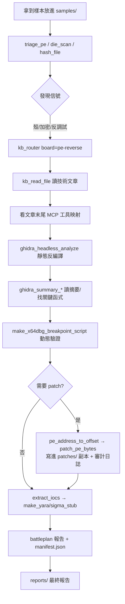

# Open-ReverseLab 專案解析報告

- 原始碼位置：`E:\source\1.Open Source\open-reverselab`
- 專案：Open-ReverseLab — AI Reverse Engineering Agent & MCP Lab
- 授權：GPL-3.0-only
- 定位：**面向 AI Agent 的開源逆向工程實驗環境**（可執行的知識庫＋MCP 工具集＋桌面工作台）
- 日期：2026-11-05

> 本報告僅說明專案的架構與運作原理，用於理解與評估。專案本身強調「合法授權範圍內」的分析，並附有 `DISCLAIMER.md` 免責聲明。

---

## 1. 它是什麼

Open-ReverseLab 不是單一程式，而是一整套**工作區約定 + 知識庫 + MCP 工具 + 桌面 App**，讓人或 AI Agent 能從「入口信號」一路推進到「證據閉環」。它的三大組成：

```
┌─────────────────────────────────────────────────────────┐
│  1. 知識庫 (kb/)                                          │
│     180+ 篇「可執行」技術文章，按攻擊面分 5 大板塊         │
│     每篇結構：場景 → 輸入信號 → 方法 → 攻擊鏈 → MCP 映射   │
├─────────────────────────────────────────────────────────┤
│  2. MCP 工具伺服器 (reverse_lab_tools)                    │
│     109 個 Python MCP 工具，包 triage / Ghidra / Frida /  │
│     rizin / patch / IOC / YARA / Android / CTF…           │
├─────────────────────────────────────────────────────────┤
│  3. 桌面工作台 (desktop/)                                 │
│     Tauri v2 + React + LangGraph.js，把攻擊網變成可視化    │
│     的自動化 Agent 流程                                    │
└─────────────────────────────────────────────────────────┘
          ▲
          │ 全部透過「目錄即約定」串起來
          ▼
   samples/ exports/ patches/ notes/ reports/ projects/ cases/
```

核心理念（來自 README）：**「實驗室是用來『跑』的，不是用來『翻』的。如果某一步不能被執行，它就不該進 KB。」**

---

## 2. 和 REA 的根本差異

你先前看的 REA 和這個 Open-ReverseLab 都是「給 AI Agent 用的逆向 MCP」，但設計哲學相反：

| 面向 | REA | Open-ReverseLab |
|---|---|---|
| 定位 | 一個精簡的 MCP，統一驅動各家引擎 | 一整套工作區：知識庫＋工具＋桌面 App |
| 語言 | TypeScript（57 萬行），架構嚴謹分層 | Python（MCP）＋ Markdown（KB）＋ React（桌面） |
| 核心資產 | 證據模型（Evidence/Unknown） | 可執行知識庫（180+ 篇攻擊鏈文章） |
| 對引擎 | 自己寫橋接注入 Hopper/Ghidra/IDA | 包裝 CLI 工具 + 接上游 MCP（GhidraMCP、JSHook） |
| 操作性 | **唯讀**，不修改目標 | **會修改**（patch 副本）、會跑工具、會打靶 |
| 導向 | 理解功能、重建程式碼 | CTF 打靶、惡意樣本研判、Android/PE 逆向 |
| 知識 | 靠 Skill 教 Agent 流程 | 靠 KB「攻擊網」路由 Agent |

一句話：**REA 像手術刀（精準、唯讀、重證據）；Open-ReverseLab 像整間手術室（工具齊全、流程化、會動手）。**

---

## 3. 目錄結構（目錄即約定）

這是本專案最重要的設計：每個產物都有固定歸宿，工具鏈靠路徑約定自動找到檔案。

```
open-reverselab/
├── kb/              知識庫 —— 5 板塊 180+ 篇攻擊鏈文章
│   ├── ctf-website/      Web CTF（26 類 118 篇）
│   ├── apk-reverse/      Android 逆向（8 類 23 篇）
│   ├── pe-reverse/       Windows PE（9 類 24 篇）
│   ├── general/          密碼/協議/作弊/韌體/SDR（5 類 17 篇）
│   └── windows/          Windows 平台專項
├── tools/
│   ├── skills/mcp/
│   │   ├── ReverseLabToolsMCP/   主 MCP 伺服器（109 工具）
│   │   ├── GhidraMCP/            接上游 LaurieWired/GhidraMCP
│   │   └── JSHookLocal/          瀏覽器 JS Hook MCP
│   ├── bin/ common/ windows/ android/ ctf-website/   工具鏈 wrapper
│   └── ai-tool-registry.json     工具註冊表
├── scripts/
│   ├── misc/            新任務、健檢、MCP 煙測、安裝、發布檢查
│   ├── ctf-website/     CTF autopilot、kb_router CLI
│   └── _shared/ghidra/  ReverseLabExportSummary.java（Ghidra 腳本）
├── boards/          板塊路由：每個板塊一份 AI-USAGE.md
├── .claude/
│   ├── workflows/      15 個 CTF workflow（24h 長跑、攻擊 router）
│   └── commands/       slash 指令
├── desktop/         Tauri + React + LangGraph 桌面工作台
├── samples/         原始樣本（永不修改）+ _quarantine/ + unpacked/
├── exports/         工具輸出（triage/ghidra/ioc/yara/sigma/procmon）
├── patches/         patch 產物（原始樣本永不修改）
├── notes/ reports/ projects/ cases/   筆記、報告、引擎專案、輕量索引
├── AGENTS.md        Agent 行為約定（最核心的指令檔）
├── AI-USAGE.md      AI 操作入口
└── CLAUDE.md        → 指向 AGENTS.md
```

**關鍵約束**：`samples/` 永不修改；要 patch 一律先複製到 `patches/`；大樣本不進 git，只在 `cases/` 建索引。

---

## 4. 底層原理

### 4.1 MCP 工具伺服器 `reverse_lab_tools`

這是整套系統的執行核心，位於 `tools/skills/mcp/ReverseLabToolsMCP/`。

- **框架**：Python，用官方 `mcp` 套件的 `FastMCP`。入口 `reverse_lab_tools_mcp.py` 用 `@mcp.tool()` 裝飾器註冊 **109 個工具**。
- **透過 `.mcp.json` 註冊**：Agent 以 `uv run` 啟動它，走 stdio。

```json
{
  "mcpServers": {
    "reverse_lab_tools": {
      "command": "uv",
      "args": ["run", "--project", "tools/skills/mcp/ReverseLabToolsMCP",
               "python", "tools/skills/mcp/ReverseLabToolsMCP/reverse_lab_tools_mcp.py"]
    }
  }
}
```

- **模組化**：每個工具只是薄包裝，真正邏輯在 `reverselab_mcp/tools/` 下的 23 個模組（triage、ghidra_headless、crypto_unpack、mutations、ioc_extract、android_mumu（2,618 行最大）…）。
- **統一錯誤處理**：`_safe_call` 把任何例外包成 `{"error": ...}`，不讓 MCP 連線崩潰。

#### 工具分類（109 個）

| 類別 | 代表工具 | 作用 |
|---|---|---|
| 初篩 triage | `hash_file`、`die_scan`、`triage_pe`、`rizin_bin_info/sections/imports/strings` | 算 hash、辨識檔案/編譯器/殼、讀節區與導入表 |
| Ghidra 靜態 | `ghidra_headless_analyze`、`ghidra_summary_*`（overview/functions/imports/strings/call_focus） | 無頭反編譯、讀摘要 |
| Patch | `pe_address_to_offset`、`patch_bytes`、`patch_pe_bytes`、`search_pattern`、`patch_pattern`、`generate_patch_report` | VA/RVA↔檔案偏移換算、修改**副本**位元組 |
| 動態腳本 | `make_x64dbg_breakpoint_script`、`make_procmon_filters`、Frida 相關 | 產生除錯器中斷點、Procmon 過濾器 |
| Android | `android_adb_*`、`android_frida_*`、`android_app_baseline`、`android_*_recipe` | ADB 控制、Frida 注入、產生分析配方 |
| 密碼/解包 | `make_pe_crypto_unpack_plan`、`extract_frida_buffers`、`solve_crypto_from_evidence`、`make_crypto_replay_scaffold` | 從證據還原加密邏輯 |
| 偵測產物 | `extract_iocs_from_summary`、`make_yara_stub`、`make_sigma_stub` | 抽 IOC、產 YARA/Sigma 規則 |
| 知識庫 | `kb_router`、`kb_read_file`、`kb_catalog` | 按信號搜尋知識庫 |
| CTF | `http_probe`、`ctf_new_challenge`、`ctf_autopilot_round`、`run_ctf_tool`、`run_sqlmap_request`、`burp_launch` | Web 打靶流程 |
| 編排 | `sample_full_workup`、`sample_autopilot_round` | 一鍵跑完整分析鏈 |
| 自檢 | `project_skills_status`、`mcp_update_audit` | 檢查 skill/MCP 狀態 |

### 4.2 安全邊界：沙箱化的檔案存取

MCP 不是隨便讀寫任意路徑。`reverselab_mcp/paths.py` 做了嚴格限制：

- `resolve_file()`：解析路徑後，必須落在 `ALLOWED_ROOTS` 之內，否則報錯。
- `resolve_patch_output()`：patch 輸出**只能**寫進 `patches/`。
- `resolve_generated_artifact()`：刪除產物時只能動 `GENERATED_ROOTS`，而且不准刪根目錄本身。
- `config.py` 用「往上找到同時有 `AGENTS.md` 和 `.mcp.json` 的目錄」來定位專案根，所有子目錄（exports、patches、projects…）都由此推導。

子程序執行（`runner.py`）在 Windows 上用 `CREATE_NO_WINDOW`、`STARTF_USESHOWWINDOW` 隱藏視窗，`stdin=DEVNULL` 避免卡住，並帶 timeout。

### 4.3 審計日誌：每次變更都留痕

`audit.py` 把每一個會改檔案的操作（例如 `patch_pe_bytes`）寫進 `exports/misc/audit/reverse_lab_tools_audit.jsonl`，一行一筆 JSON，含：

- `operation_id`（UUID）、`timestamp`（UTC）
- `action`、`source_path`、`destination_path`
- `address`、`file_offset`、`old_bytes_hex`、`new_bytes_hex`

這讓 AI 的每次「動手」都可追溯、可回放、可回滾。

### 4.4 知識庫「攻擊網」與 kb_router

這是本專案導引 Agent 的核心機制，取代 REA 的「證據模型」路線。

- 每個板塊有一份 `kb-index.json`，每個條目帶 `signals`（信號關鍵字）、`files`（技術文章）、`priority`。
- `kb_router(query, board)` 的運作（`web_ctf.py._search_kb`）是一個**簡單的加權比對**：

  ```
  query 命中 entry.id       → +5
  query 與某個 signal 互相包含 → +10   （信號是最強的路由依據）
  query 命中檔名             → +3
  ```

  把所有板塊的結果依分數排序，回傳 top 10 和各板塊分組。

- 流程：Agent 發現一個信號（例如 "JWT"、"脫壳"、"PRNG"）→ 呼叫 `kb_router` → 讀出排名最高的技術文章 → 文章末尾有「## MCP 工具映射」表，指出哪一步可以用哪個 MCP 工具自動化。
- 每個板塊還有一份 `attack-network.md`，用 Mermaid 畫出「多入口、多分叉」的攻擊圖，讓 Agent 不要只走一條線。

### 4.5 編排工具 `sample_full_workup`（一鍵分析鏈）

`workflow.py` 的 `sample_full_workup` 示範了「證據閉環」如何自動化。對一個樣本，它依序跑：

```
triage_pe
  → (可選) ghidra_headless_analyze
  → ghidra_summary_overview / call_focus
  → triage_to_notes（寫分析筆記）
  → make_x64dbg_breakpoint_script（產中斷點腳本）
  → make_procmon_filters（產 Procmon 過濾器）
  → extract_iocs_from_summary → refine_ioc_sources
  → make_yara_stub / make_sigma_stub
  → 彙整成 battleplan 報告 + manifest.json
```

每一步的狀態是 `ok / error / skipped`，單步失敗不影響其他步驟（`_safe_step`），最後產出所有產物路徑清單和一份 `manifest.json` 當恢復點。

### 4.6 Ghidra 無頭分析

`ghidra_headless.py` 不自己寫橋接，而是直接呼叫 Ghidra 的 `analyzeHeadless.bat`：

```
analyzeHeadless <projects> <project_name>
  -import <sample>
  -scriptPath scripts/_shared/ghidra
  -postScript ReverseLabExportSummary.java <output.json> <函式上限> <字串上限> <導入上限>
  -analysisTimeoutPerFile <秒>
```

Ghidra 分析完後由 `ReverseLabExportSummary.java` 把結果輸出成 JSON（函式、字串、導入表），再由 `ghidra_summary_*` 系列工具讀取。另有 `.mcp.optional.example.json` 可接上游 `GhidraMCP`（LaurieWired）做互動式分析。

### 4.7 桌面工作台（Tauri + LangGraph）

`desktop/` 是一個把攻擊網「可視化 + 自動化」的 App，架構嚴謹（`ARCHITECTURE.md`）：

- **技術棧**：Tauri v2（Rust 殼）+ React 19 + `@xyflow/react`（拓撲畫布）+ `@langchain/langgraph`（狀態機）+ Mermaid。
- **四層解耦**：
  1. 領域契約層 `src/core/types.ts`：純型別，禁止引入 UI 庫。
  2. 業務服務層 `src/services/`：LoggerService（發布訂閱日誌）、DiagnosticService（工具鏈探針）。
  3. 應用狀態層 `HarnessContext`：單一資料源。
  4. 表現層 `src/views/`：拓撲畫布、終端日誌、診斷中心三個同級視圖。
- **核心引擎**：LangGraph.js StateGraph 狀態機，流程是 `Triage → KB 攻擊網路由 → 並行子 Agent 分支 → 戰利品結算`，子 Agent 透過 Tauri Command / MCP 呼叫 Ghidra / Frida / x64dbg。

### 4.8 Agent 上下文鏈與環境快照

- **上下文鏈**：Agent 啟動時依序載入 `CLAUDE.md → AGENTS.md → AI-USAGE.md → boards/<board>/AI-USAGE.md`，一層層把全域規範收斂到當前板塊。
- **環境快照協議**：首次用 AI 開專案時，Agent 探測本機環境（系統、工具鏈、Python 逆向庫、設備…），寫入**本機級**的 `~/.open-reverselab/env/env.md`，跨專案共享、7 天或協議升級才重探；環境變數依協議脫敏（密鑰只標「已設置」）。
- **24h 長跑**：`.claude/workflows/` 裡有 15 個 workflow，配合 `/loop` 做不中斷打靶，每輪輸出 `STATUS: CONTINUE|DONE|EXHAUSTED`，用 `cases/<case>/ai_manifest.json` 當恢復點。

---

## 5. 一次完整流程範例（PE 樣本）



對照你之前 HelloWorld.exe 改字串的例子，用本專案的工具就是：

| 手動做的 | Open-ReverseLab 工具 |
|---|---|
| 找字串與反組譯 | `triage_pe` → `ghidra_headless_analyze` → `ghidra_summary_strings` |
| VA 0x417B30 轉偏移 0x6330 | `pe_address_to_offset(path, "0x417B30", "va")` |
| 把 'A'(0x41) 改成 'H'(0x48) | `patch_pe_bytes(path, "0x6330", "48")` → 寫進 `patches/`，原檔不動，並記審計 |
| 產出報告 | `generate_patch_report` |

注意差異：REA **不會** patch，Open-ReverseLab **會** patch，但一律改副本並留審計紀錄，原始樣本永不修改。

---

## 6. 小結

Open-ReverseLab 是一套「Agent 原生」的逆向工作區，用三個支柱運作：

1. **知識庫（kb/）**：把逆向經驗寫成可執行的「攻擊網」文章，用 `kb_router` 按信號路由。
2. **MCP 工具（reverse_lab_tools）**：109 個 Python 工具，沙箱化檔案存取 + 審計日誌 + 一鍵編排鏈。
3. **桌面工作台（desktop/）**：Tauri + LangGraph 把流程可視化、自動化。

加上「目錄即約定」把產物歸位、上下文鏈把 Agent 收斂到板塊、環境快照做跨會話記憶，構成一個讓 AI 能自主、可追溯、可恢復地完成逆向任務的環境。

---

## 7. 主要參考檔案

| 檔案 | 說明 |
|---|---|
| `README.md` / `README.zh.md` | 專案總覽 |
| `AGENTS.md` | Agent 行為約定（最核心） |
| `.mcp.json` / `.mcp.optional.example.json` | MCP 註冊 |
| `tools/skills/mcp/ReverseLabToolsMCP/reverse_lab_tools_mcp.py` | 109 個 MCP 工具入口 |
| `.../reverselab_mcp/config.py` | 專案根與目錄定位 |
| `.../reverselab_mcp/paths.py` | 沙箱化路徑檢查 |
| `.../reverselab_mcp/audit.py` | 審計日誌 |
| `.../reverselab_mcp/tools/workflow.py` | `sample_full_workup` 編排鏈 |
| `.../reverselab_mcp/tools/web_ctf.py` | `kb_router` 知識庫路由 |
| `.../reverselab_mcp/tools/ghidra_headless.py` | Ghidra 無頭分析 |
| `kb/*/techniques/kb-index.json` | 信號→文章索引 |
| `kb/*/techniques/attack-network.md` | 攻擊網 Mermaid 圖 |
| `desktop/ARCHITECTURE.md` | 桌面工作台架構 |
| `.claude/workflows/README.md` | 24h 長跑與攻擊 workflow |
